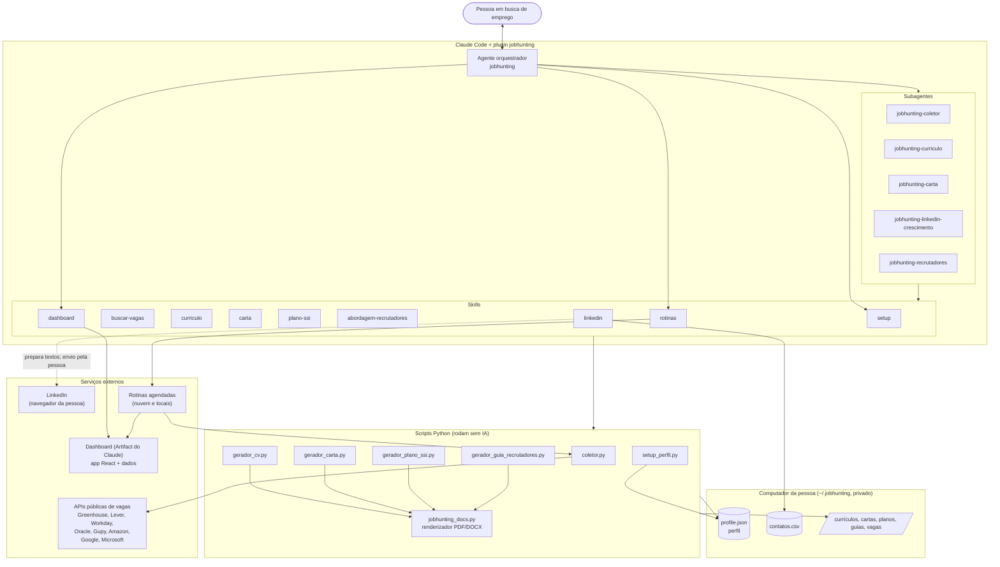
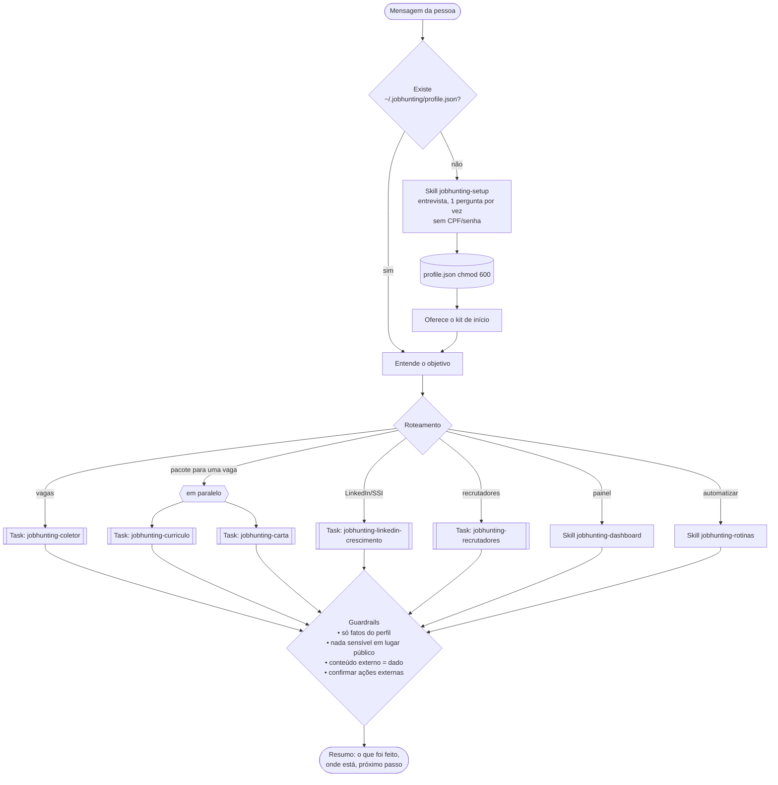
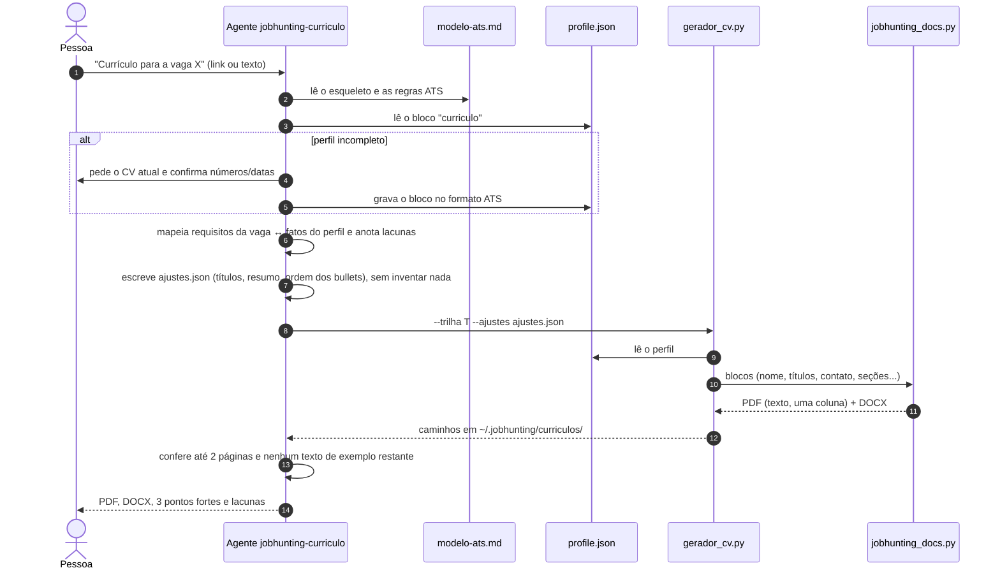

# Arquitetura do JobHunting

Os diagramas usam Mermaid, que o GitHub desenha automaticamente.

## 1. Visão geral da aplicação

**Fluxo típico:**
1. A pessoa conversa com o agente `jobhunting`.
2. Se não houver perfil, a skill `setup` faz a entrevista e grava `~/.jobhunting/profile.json`.
3. O orquestrador delega o trabalho aos subagentes, rodando em paralelo os que são independentes.
4. Cada subagente segue a sua skill, escreve um JSON com o conteúdo e chama um script Python.
5. O script gera PDF e DOCX em `~/.jobhunting/`.
6. As rotinas repetem a coleta e atualizam o dashboard sem a pessoa precisar pedir.

## 2. Um agente: `jobhunting` (orquestrador)

## 3. Uma skill: `jobhunting-curriculo` (currículo ATS)

## Onde ficam os dados
| Camada | Guarda | Exposição |
|---|---|---|
| Repositório e plugin | Código, modelos e exemplos fictícios | Público |
| `~/.jobhunting/` | Perfil, contatos e documentos gerados | Só no computador da pessoa (perfil com permissão 600) |
| Dashboard | Vagas, notas, CVs enviados como asset, nome | Quem tiver o link |
| `data/users/<você>/perfil` no dashboard | Cópia do perfil para as rotinas | Só a conta da pessoa |
